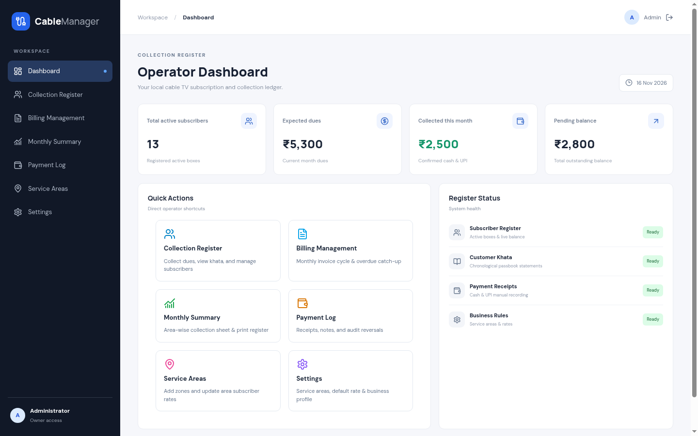
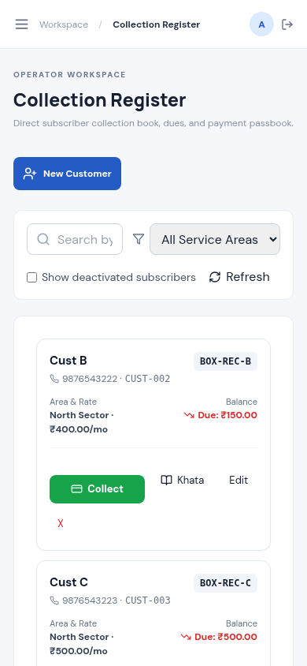
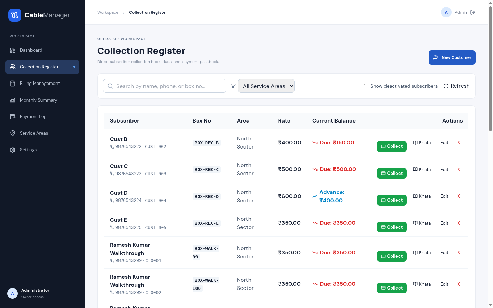
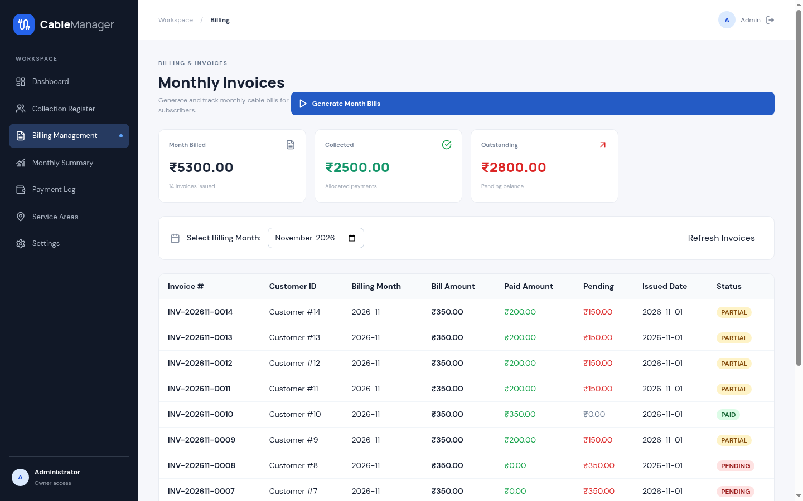
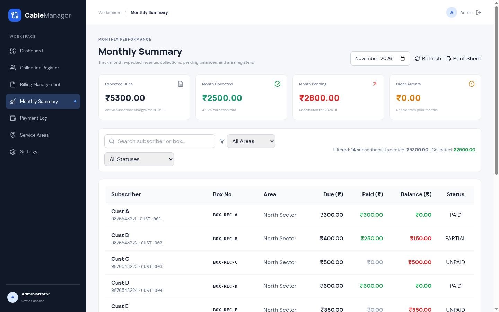
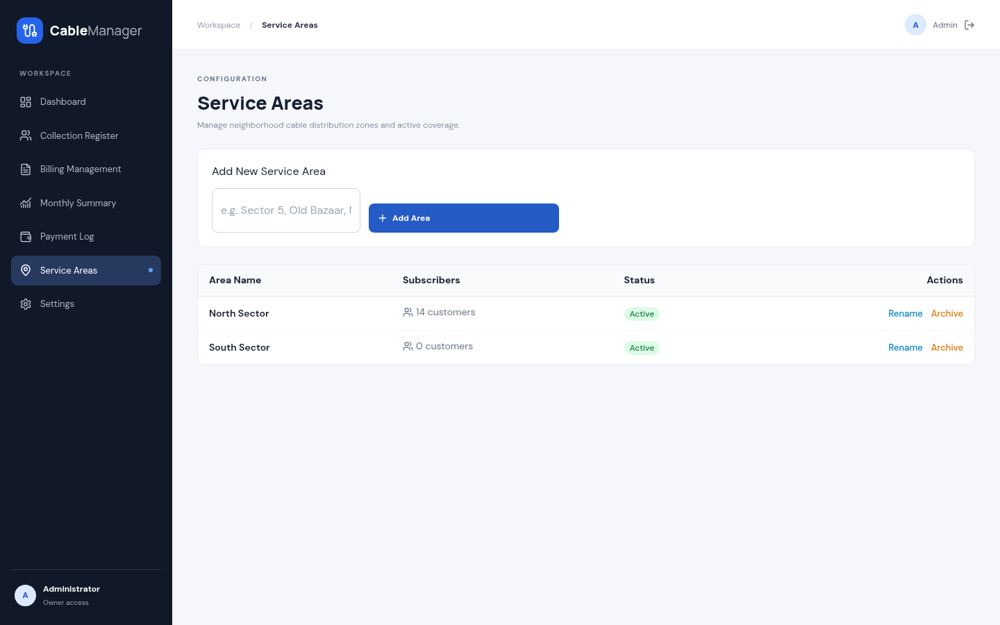
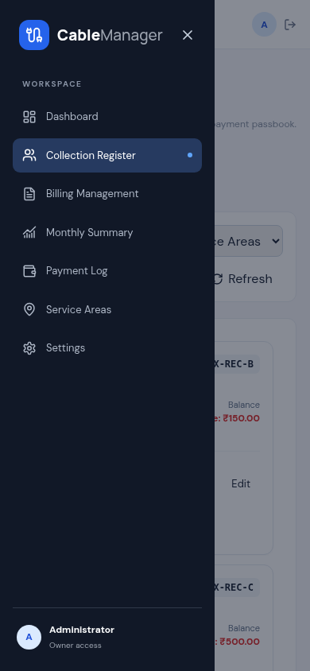

# Cable Data Manager

**A modern, self-hosted customer and payment management web application for independent local cable TV operators.**

[](LICENSE)
[](https://www.python.org/)
[](https://fastapi.tiangolo.com/)
[](https://react.dev/)
[](https://www.postgresql.org/)
[](https://docs.docker.com/compose/)

---

## 1. Project Introduction

Independent local cable TV operators in India manage hundreds of residential subscribers, collecting monthly subscription fees via cash and UPI. Many operators still rely on paper registers or complex multi-tenant commercial SaaS products that charge recurring subscription fees, expose customer records to third parties, or stop working during broadband outages.

**Cable Data Manager** is designed from the ground up for independent local operators:
- **100% Free & Open Source:** Zero monthly fees, zero per-subscriber pricing, zero feature paywalls.
- **Strict Data Privacy:** Zero external telemetry or analytics. All subscriber profiles and financial ledgers stay strictly on your local machine.
- **Offline / Local LAN Operation:** Runs independently over localhost or local Wi-Fi/Ethernet without requiring continuous internet access.
- **Dedicated Single-Operator Database:** One independent database per installation. No shared cloud infrastructure.
- **Financial Exactitude:** Full `Numeric(12, 2)` monetary precision (never floating-point). Overpayment advance credits, chronological Khata passbooks, and auditable payment reversals.

---

## 2. Product Showcase

### Operator Dashboard


### Desktop & Mobile Experience
| Desktop Collection Register | Mobile Cards (< 700px) |
|:---:|:---:|
|  |  |

| Customer Khata Passbook | Payment Collection Modal |
|:---:|:---:|
|  |  |

| Monthly Billing Engine | Revenue Reports & Summaries |
|:---:|:---:|
|  |  |

| Service Area Management | Mobile Navigation Drawer |
|:---:|:---:|
|  |  |

---

## 3. Key Features

- **📋 Collection Register:**
  - Subscriber directory searchable by customer name, mobile number, or Set-Top Box (STB) number.
  - Payment status badges: **Paid**, **Partial**, **Unpaid**, and **Advance Credit**.
  - Dual view: Full desktop table for office computers and responsive mobile cards (`< 700px`) for smartphones and collection agents in the field.
- **💰 Financial Engine & Chronological Khata:**
  - Complete chronological passbook recording opening balance, monthly invoices, cash/UPI receipts, and payment reversals.
  - Automatic advance credit roll-forward: excess payments automatically offset subsequent monthly invoices.
  - Reversible transactions with mandatory audit notes to track corrections transparently.
- **📅 Billing Automation:**
  - One-click monthly invoice generation across all active subscribers according to their configured monthly plan.
  - Idempotent generation engine guarantees zero duplicate billing for the same subscriber in a billing cycle.
- **📍 Service Area Segmentation:**
  - Partition subscribers into local delivery zones (e.g., "Main Road", "Sector 4", "Gandhi Nagar").
  - Live subscriber counts per area to simplify field collection routes.
- **🔒 Production-Hardened Security:**
  - **Argon2id** password hashing (`t=3, m=65536, p=4`) with strict entropy validation ($\ge 12$ characters).
  - Sliding-window in-memory brute-force rate limiter on login endpoints.
  - Unprivileged non-root Docker containers (`USER appuser:10001` and `USER nginx:101`).
  - Hardened Nginx proxy with strict `Content-Security-Policy`, `X-Frame-Options: DENY`, and `X-Content-Type-Options: nosniff`.
  - Self-hosted typography (`@fontsource/dm-sans` & `@fontsource/manrope`) ensuring zero external font CDN calls.
- **💾 Automated Disaster Recovery:**
  - Unattended streaming encrypted database backups via systemd timer.
  - Asymmetric public-key encryption (GPG): public key on the host encrypts nightly dumps; private key is kept strictly offline by the business owner.

---

## 4. Technology Stack

| Layer | Component | Version | Purpose |
|---|---|---|---|
| **Frontend** | React, TypeScript, Vite, Tailwind CSS | 18.3 / 6.0 | Fast, responsive single-page application |
| **Typography** | `@fontsource/dm-sans`, `@fontsource/manrope` | Latest | 100% self-hosted, offline WOFF2 fonts |
| **Backend API** | Python, FastAPI, Pydantic v2 | 3.12 / 0.115 | Asynchronous REST backend |
| **Database** | PostgreSQL | 16 | ACID relational database with `Numeric(12, 2)` financial precision |
| **Migrations** | Alembic | 1.14 | Version-controlled database schema management |
| **Reverse Proxy** | Nginx (Alpine) | 1.27 | Hardened reverse proxy, asset caching, security headers |
| **Packaging** | Docker Compose | v2 | Multi-container reproducible production deployment |
| **Backup** | Bash, `pg_dump`, GnuPG 2 | Latest | Encrypted streaming backups to external USB storage |

---

## 5. System Architecture

```text
+-------------------------------------------------------------------------+
| Local Computer / Server (Host Machine)                                  |
|                                                                         |
|  Browser (Localhost or LAN Mobile Device)                               |
|        |                                                                |
|        | HTTP Port 8080 (127.0.0.1 or LAN IP)                           |
|        v                                                                |
|  +-------------------------------------------------------------------+  |
|  | Nginx Container (:8080)                                           |  |
|  | - Serves React Static Bundle & Self-Hosted Typography             |  |
|  | - Proxies /api/* to FastAPI backend                               |  |
|  | - Security Headers, Caching, and Request Buffering                |  |
|  +---------------------------------+---------------------------------+  |
|                                    | (Isolated Docker Network)          |
|                                    v                                    |
|                 +------------------------------------+                  |
|                 | FastAPI Backend Container (:8000)  |                  |
|                 | - Lifespan DB Connection & Seeding |                  |
|                 | - Argon2id & Rate Limiting Engine  |                  |
|                 | - Financial Engine & Business APIs |                  |
|                 +------------------+-----------------+                  |
|                                    | (Internal DB Port Only)            |
|                                    v                                    |
|                 +------------------------------------+                  |
|                 | PostgreSQL 16 Database (:5432)     |                  |
|                 | - Numeric(12, 2) Ledger Tables     |                  |
|                 | - Unexposed to Host Network        |                  |
|                 +------------------+-----------------+                  |
|                                    |                                    |
|                                    v (Encrypted Pipe: pg_dump | gpg)    |
|                 +------------------------------------+                  |
|                 | External USB Storage: /mnt/...     |                  |
|                 +------------------------------------+                  |
+-------------------------------------------------------------------------+
```

---

## 6. Installation & Deployment

We support two installation paths:

### Approach A: Production Docker Compose (Recommended & Verified)

#### Prerequisites
- **Operating System:** Ubuntu Server/Desktop 22.04/24.04 LTS or Debian 12 (recommended).
- **Docker Engine & Docker Compose v2** installed.
- **Hardware:** 4 GB RAM minimum (8 GB recommended), 20 GB available disk space.
- **Backup Target:** Dedicated external USB drive mounted at `/mnt/cable-manager-backups`.

#### Step 1: Clone the Repository
```bash
git clone https://github.com/nani-a11y/cable-data-manager.git /opt/cable-data-manager
cd /opt/cable-data-manager
```

#### Step 2: Configure Environment Variables
Copy the production environment template and set restricted file permissions:
```bash
cp .env.example .env
chmod 0600 .env
```

Open `.env` in your text editor (`nano .env`) and set production values:
1. Generate a strong database password:
   ```bash
   openssl rand -hex 24
   ```
2. Generate a 256-bit JWT secret ($\ge 32$ characters required in production):
   ```bash
   openssl rand -hex 32
   ```
3. Set your initial administrator login email and password (`ADMIN_EMAIL` and `ADMIN_PASSWORD`).
4. Ensure `APP_ENV=production`.

#### Step 3: Run Database Migrations
Start the isolated PostgreSQL database service and apply Alembic migrations:
```bash
# Start PostgreSQL database container
docker compose -f docker-compose.prod.yml up -d db

# Apply schema migrations to head revision
docker compose -f docker-compose.prod.yml run --rm backend alembic upgrade head
```

#### Step 4: Launch the Full Application
```bash
docker compose -f docker-compose.prod.yml up -d
```

Verify that all three services are running and healthy:
```bash
docker compose -f docker-compose.prod.yml ps
```

Open your browser to:
```text
http://localhost:8080
```

---

### Approach B: Guided Interactive Installer (`scripts/install.sh`) [Planned]

> [!NOTE]
> **Status: In Roadmap for Release v1.1.**<br/>
> An automated, menu-driven bash installer script (`scripts/install.sh`) is in development to automate prerequisite detection, secret generation, GPG key creation, and systemd registration in a single interactive terminal walkthrough. For production use today, follow **Approach A (Production Docker Compose)** above.

---

## 7. Operational Workflow Guide

1. **Log In:** Navigate to `http://localhost:8080`, enter your configured administrator credentials, and log in.
2. **Initial Business Profile:** Open **Settings** and configure your business name, contact phone, street address, currency, and default monthly rate (e.g. ₹300).
3. **Configure Service Areas:** Open **Service Areas** and create delivery zones (e.g. "North Sector", "Main Market").
4. **Register Customers:** In **Collection Register**, click **New Customer**, fill in their subscriber details, STB number, and assigned area.
5. **Collect Payments:** On any customer row or card, click **Collect**, choose payment mode (Cash or UPI), enter amount, and submit. The Khata balance updates immediately.
6. **Monthly Billing Cycle:** On the 1st of each month, navigate to **Billing Management** and click **Generate Monthly Invoices** to bill all active subscribers idempotently.
7. **Review Revenue:** Navigate to **Monthly Summary** to audit total collections, outstanding dues, and collection percentages.

---

## 8. Administrative Password Reset CLI

If the administrator password is ever forgotten, it can be reset safely from the host terminal without plaintext logging or database inspection:

```bash
docker compose -f docker-compose.prod.yml run --rm backend python -m app.cli reset-admin-password --email your-email@example.com
```

The CLI prompts interactively with masked input, enforces production password policies, and updates the hash transactionally.

---

## 9. Backup & Disaster Recovery

Nightly backups are automated via systemd timer and GPG public-key stream encryption:
- Backups are written directly to `/mnt/cable-manager-backups` (dedicated external USB SSD).
- The public key on the server encrypts dumps during unattended nightly execution.
- The private decryption key is kept strictly offline by the business owner.
- To inspect backup status:
  ```bash
  bash scripts/backup/backup-status.sh
  ```
- Detailed setup instructions are documented in [`docs/deployment/BACKUP_OPERATIONS_GUIDE.md`](docs/deployment/BACKUP_OPERATIONS_GUIDE.md).

---

## 10. Local Development & Testing

To run the application locally in development mode:
```bash
# 1. Backend Setup
cd backend
python3 -m venv .venv
source .venv/bin/activate
pip install -r requirements-dev.lock

# Run Pytest Regression Suite (100 tests)
pytest tests -v

# 2. Frontend Setup
cd ../frontend
npm ci
npm run dev
```

The development server runs on `http://127.0.0.1:5173` with hot-module reloading.

---

## 11. Project Directory Structure

```text
├── backend/
│   ├── alembic/                # Database migrations (0001, 0002, 0003)
│   ├── app/                    # FastAPI application, routes, models, and services
│   │   ├── cli.py              # Administration CLI (password reset)
│   │   ├── config.py           # Production environment validation
│   │   ├── models.py           # SQLAlchemy 2.0 database models
│   │   ├── rate_limiter.py     # Login brute-force rate limiter
│   │   ├── security.py         # Argon2id hashing and password policies
│   │   └── routes/             # Auth, customers, billing, payments, settings
│   ├── tests/                  # Pytest test suite (100 collected test cases)
│   ├── Dockerfile.prod         # Unprivileged Python 3.12 production container
│   └── requirements*.lock      # Cryptographically locked dependencies with SHA-256 hashes
├── frontend/
│   ├── src/                    # React components, views, styles, and API client
│   │   ├── App.tsx             # Main routing and navigation shell
│   │   ├── CustomersView.tsx   # Collection register (desktop table & mobile cards)
│   │   ├── BillingView.tsx     # Monthly invoice cycle manager
│   │   ├── ReportsView.tsx     # Monthly collection register and revenue reports
│   │   ├── PaymentsView.tsx    # Receipt log and audit reversals
│   │   ├── AreasView.tsx       # Service area management
│   │   └── BusinessSetup.tsx   # Operator profile and billing parameters
│   ├── public/                 # Static favicon and branding assets
│   ├── Dockerfile.prod         # Multi-stage Node build with Nginx reverse proxy
│   └── nginx.prod.conf         # Hardened Nginx production configuration
├── docs/
│   ├── architecture/           # System, database, and security specifications
│   ├── deployment/             # Step-by-step production installation runbooks
│   ├── images/                 # Real application screenshots for repository gallery
│   └── quality/                # Sprint verification and audit reports
├── scripts/
│   ├── backup/                 # GPG backup, restore, retention, and systemd units
│   └── health-check.sh         # Deployment verification scripts
├── docker-compose.prod.yml     # Hardened production Compose configuration
└── docker-compose.yml          # Local development Compose configuration
```

---

## 12. Contribution Guidelines

Contributions are welcome! Please open an issue to discuss proposed enhancements before submitting pull requests. All pull requests must pass automated pytest regression tests (`pytest tests`) and code formatting checks (`git diff --check`).

---

## 13. License

This project is open-source software licensed under the terms of the [MIT License](LICENSE).
