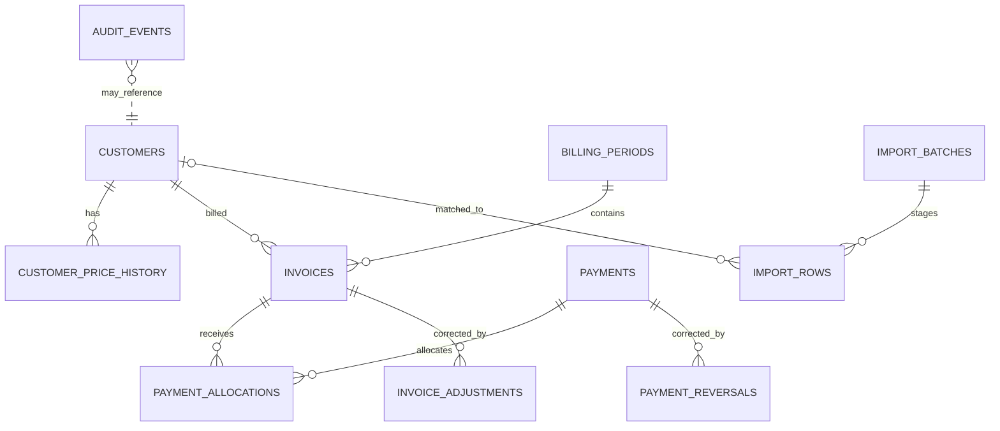

# Database design

**Status:** current schema/metadata inspected read-only; the future schema below
is a proposal. No migration or database mutation was performed.

## Verified current database

- PostgreSQL 16 Alpine is healthy and reachable by the backend.
- Existing named volume `cable-manager-phase1_postgres_data` is present and was
  not modified. A separate `open-webui` volume was left untouched.
- The `public` schema has only `admin_users`; metadata shows five columns:
  `id`, `email`, `password_hash`, `is_active`, `created_at`.
- A count query returned one admin row. No row contents, email, hash, customer
  data, or payment data were read.
- The email uniqueness is implemented as a unique index. There is also a
  redundant ordinary index on the primary-key `id`.
- No Alembic migration table or business tables were found. SQLAlchemy
  `create_all()` is the current schema bootstrap.

## Proposed normalized model

### Tables and key rules

| Table | Core data and rules |
|---|---|
| `customers` | UUID/key, stable customer number, name, optional phone/address/area, active/archive timestamps, `version`. Unique customer number; phone is not unique because households may share a number. Financial history uses restrictive foreign keys. |
| `pricing_settings` | One business-default row, currency, default monthly amount `NUMERIC(12,2)`, effective/updated metadata, version. Currency is fixed after monetary records exist unless a reviewed migration handles it. |
| `customer_price_history` | Customer, `NUMERIC(12,2)` price, `effective_from`, exclusive `effective_to`, reason and creation metadata. Unique `(customer_id,effective_from)`, positive price, valid date interval, and no overlapping intervals per customer. PostgreSQL exclusion constraint with `btree_gist` is a candidate; confirm extension policy before migration. |
| `billing_periods` | Inclusive start/exclusive end dates, label, lifecycle status; unique period boundaries and valid interval. Model calendar periods explicitly rather than infer them from request time. |
| `invoices` | Customer and billing-period FKs, unique invoice number, issue/due timestamps or dates, immutable price/description/currency/total snapshot, status and version. Unique `(customer_id,billing_period_id)` prevents duplicate issuance. |
| `payments` | Immutable receipt event, amount `NUMERIC(12,2)`, currency, paid timestamp, method/reference, idempotency key and creation metadata. Positive amount; no destructive delete. |
| `payment_allocations` | Payment, invoice, amount `NUMERIC(12,2)`, allocation metadata. Positive amounts, same-customer/currency rule, indexed FKs. Aggregate limits are enforced inside a locked transaction, not by a row-level `CHECK`. |
| `payment_reversals` / allocation reversal events | Append-only references to the original payment/allocation, amount, reason, timestamp, actor. Partial corrections are separate events; original receipt remains intact. |
| `invoice_adjustments` | Append-only credit/debit or reversal event linked to an issued invoice, amount and reason. A corrected invoice is not overwritten. |
| `audit_events` | Timestamp, verified gateway actor, action, entity reference, request/correlation ID, reason and minimal before/after change data. Append-only application behavior; never store passwords, tokens, or unnecessary PII snapshots. |
| `import_batches` | Sanitized source label/checksum, status, counts, operator approval metadata, creation time. Tracks preview through approval/application. |
| `import_rows` | Batch/row number, normalized candidate fields, validation errors, duplicate/match decision and applied result. Unique `(batch_id,row_number)`; staging data is not business data before approval. |

Do not store an independently editable `outstanding_balance`. Derive it as
issued invoice amounts plus invoice adjustments minus effective allocations and
payment/allocation reversals. A materialized/cache table is unnecessary at the
expected scale; if later introduced, it must be transactionally maintained and
reconciled against the ledger.

## Monetary and billing invariants

1. Use PostgreSQL `NUMERIC(12,2)` and Python `Decimal`; never `float`. Expose
   money as decimal strings in JSON.
2. Snapshot the effective customer price and other invoice facts at issuance.
   Later pricing changes affect only future periods.
3. Enforce unique `(customer_id,billing_period_id)` in the database, and create
   invoice plus audit event in one transaction. Idempotency keys help clients
   safely retry.
4. Keep each period invoice charge separate. A prior unpaid invoice remains
   outstanding through the ledger; do not add it again as a new period charge.
   A verified legacy opening amount, if needed, is represented once as an
   explicitly identified opening invoice/adjustment with provenance.
5. Allocate a partial payment only up to the unallocated effective payment
   amount and eligible invoice amount. Handle overpayment as an explicit
   unallocated credit or reject it after owner policy is decided.
6. Corrections are reversal/adjustment events. Archived customers and financial
   rows are retained; foreign keys use `RESTRICT`/non-cascading behavior.
7. Effective-price date ranges must not overlap. If the `btree_gist` exclusion
   constraint is not approved, enforce the same rule with a serialized
   transaction and a database lock, plus a unique start-date constraint.
8. Invoice and payment status is derived from ledger events or transitioned
   atomically with auditable history; it must not contradict allocation totals.

## Constraints, indexes, and concurrency

- Primary keys on all tables; unique customer number, invoice number, billing
  period boundaries, customer/period invoice pair, import batch row, and
  payment idempotency key.
- Checks for positive money, valid date intervals, allowed state values, and
  three-character currency codes.
- Index customer search/sorting fields (including area/active and stable number),
  price history `(customer_id,effective_from)`, invoices by
  `(customer_id,issued_on)` and `(status,due_date)`, allocations by both
  payment and invoice, payments by `(paid_at)`, audit by entity/time, and import
  batches by status/creation time.
- Lock the customer/period and affected invoice/payment rows with
  `SELECT ... FOR UPDATE` while issuing/allocating; use optimistic `version`
  checks for customer edits and API `If-Match`/version conflicts. Treat unique
  constraint violations as a visible `409`, not silent overwrites.
- Use database transactions for invoice generation, payment posting/allocation,
  reversal, and import approval.

## Migration and preservation plan

Introduce Alembic with a reviewed baseline of the existing `admin_users` schema.
Do not run `create_all()` as a replacement for versioned migrations in
production. Do not drop the existing table/account or reuse its volume for a
new schema without a backup and explicit approval. The target eliminates
application login, but retention/removal of the existing account is a separate
owner-approved migration decision. No customer/payment tables or records exist
in the inspected current schema.

## Decisions required before schema implementation

Confirm currency, tax/rounding, billing boundaries, invoice number format,
price effective-date rules, suspended-service billing, payment allocation
order, overpayment/refund behavior, opening balance source, retention policy,
and whether the `btree_gist` extension is acceptable.
