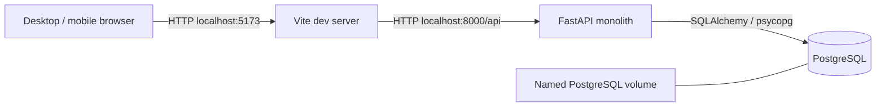
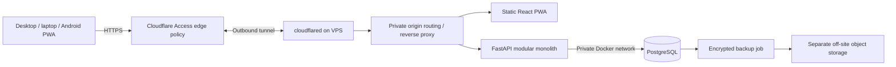

# System architecture

**Status:** existing topology is verified; target topology is proposed. No
cloud deployment or authentication change was performed.

## Verified current architecture

The application is a small modular monolith: one React/Vite frontend, one
FastAPI/SQLAlchemy backend, and one PostgreSQL database managed by Docker
Compose. The database is the only service with a Compose health check.

Compose binds frontend and backend ports to host loopback; PostgreSQL has no
published host port and is reachable on the Compose network. The frontend image
runs Vite's development server and has no source bind mount. This is a local
development arrangement, not a production deployment. The backend creates its
schema with SQLAlchemy `create_all()` and conditionally seeds one admin account.

## Proposed target topology

The tunnel is outbound-only from the VPS; the VPS should have no public
application or database listener. Access policy protects every browser/API path.
The origin routes frontend and `/api/v1` through the same hostname to avoid
unnecessary cross-origin requests. PostgreSQL remains on an internal Docker
network. Backups leave the VPS only after encryption.

## Component responsibilities

- **PWA frontend:** presentation, client-side validation, responsive workflows,
  import preview UI, and API calls. It is not a security boundary and does not
  make financial decisions authoritative.
- **FastAPI monolith:** input validation, domain rules, transaction boundaries,
  invoice/payment operations, import approval, and query/report APIs.
- **PostgreSQL:** source of truth for customer, price, invoice, payment,
  allocation, audit, and import state.
- **Access gateway:** human identity and MFA policy before application traffic
  reaches the origin. It is not a customer/user table in the app.
- **Tunnel/reverse proxy:** private routing and HTTPS-origin handling; only the
  gateway/tunnel path can reach the app.
- **Backup job/storage:** encrypted logical backups, retention, integrity
  verification, and restore drills.

## Request and data flow

1. The operator opens the private HTTPS hostname and completes gateway identity
   verification.
2. The gateway forwards a permitted request through the tunnel to the private
   origin.
3. The frontend sends a same-origin API request. No application JWT login is
   required in the target design.
4. FastAPI validates the request, applies business rules in a transaction, and
   reads/writes PostgreSQL on the private network.
5. Responses use decimal strings for money and never expose credentials or
   internal database configuration.

If the backend needs an actor for audit history, it may use only an identity
assertion whose source is guaranteed by the gateway and whose origin cannot be
reached directly. Do not trust a forgeable forwarded-email header on a public
origin.

## Security and network boundaries

- Public edge: gateway-protected HTTPS only.
- VPS: outbound tunnel connection; SSH restricted separately to the operator's
  management policy.
- Docker: application/API and database on private networks; no public PostgreSQL
  mapping. In production, avoid host-published API/frontend ports unless bound
  to loopback behind a local proxy.
- Browser: do not store a reusable app JWT in localStorage in the target.
- Storage: backup encryption keys remain separate from the VPS and backup
  objects.
- Development: current `localhost` bindings are local-only; never expose the
  current development Vite server directly to the Internet.

## Failure scenarios and recovery

| Failure | Expected behavior | Recovery |
|---|---|---|
| Internet, Access, or tunnel unavailable | Remote app is unavailable; no public-origin bypass | Restore provider/network/tunnel; use documented account recovery |
| VPS/container failure | App unavailable; database volume remains attached to host | Recreate services from pinned artifacts; restore only if volume is damaged |
| PostgreSQL corruption/host loss | Stop writes; preserve original volume for investigation | Restore latest verified encrypted backup to an isolated/new volume, validate, then cut over |
| Bad schema release | Reject/rollback release; do not blindly reverse destructive migrations | Restore from pre-change backup or use a reviewed forward repair |
| Duplicate/concurrent billing request | Unique constraint/idempotency and transaction reject duplicates | Return conflict and let operator review |
| Backup key unavailable | Backup cannot be restored | Keep separately protected recovery copy; test access during restore drills |
| Gateway account compromise | Revoke sessions/identity and review access logs | IdP recovery and gateway policy review; application data review |

Availability objectives are not set. A daily backup implies up to one day of
data loss; choose a tighter RPO only if WAL archiving and its operational burden
are accepted.

## Alternatives and trade-offs

- **Cloudflare Tunnel + Access (recommended for evaluation):** no inbound VPS
  application port, browser access without installing a VPN on every device,
  managed HTTPS and identity policy. Trade-offs are provider dependency,
  account/domain setup, plan limits/pricing that must be checked at adoption,
  and trust in provider handling of connection metadata.
- **Tailscale:** private mesh access with strong device identity and no public
  web origin; attractive if all devices can install and maintain a client.
  Android and desktop browser use is supported through the private network, but
  this is less frictionless for occasional/new devices and not a public PWA URL.
- **Self-managed WireGuard:** minimal third-party access dependency and strong
  private-network model; requires key distribution, revocation, endpoint
  maintenance, and device onboarding by the owner.
- **Public reverse proxy + HTTPS alone:** not acceptable for this product
  because it provides transport encryption, not operator-only access. It would
  expose APIs without an authentication boundary.

This is a product/operations choice, not authorization to create a Cloudflare
account, tunnel, DNS record, VPS, or public deployment.
