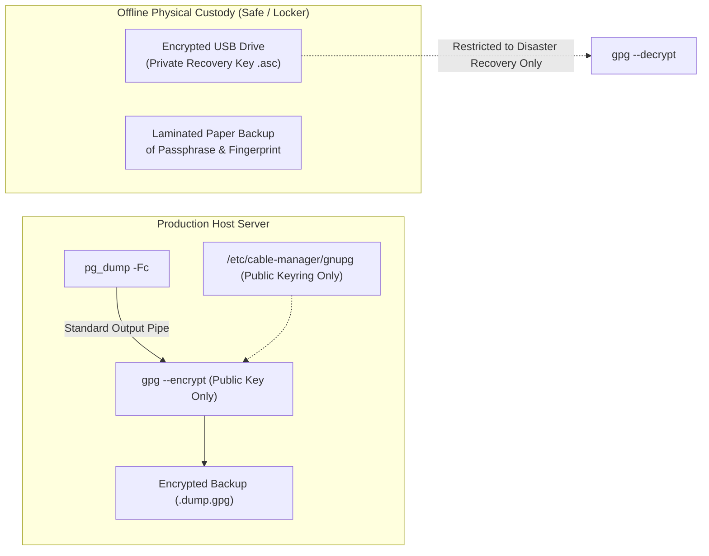

# Production Backup & Recovery Operations Guide

**Project:** Cable Data Manager  
**Audience:** System Administrators & Backup Engineers  
**Target Storage:** Dedicated External USB 3.0 SSD (`/mnt/cable-manager-backups`)  
**Security Profile:** GPG Public-Key Stream Encryption, SHA-256 Manifests, Sliding Retention

---

## 1. Physical Hardware & Storage Preparation

To protect customer billing records and payment passbooks against host hardware failure or ransomware, backups must be written directly to a physically separate external drive.

### 1.1 Drive Selection & Partitioning
- **Hardware:** Dedicated external USB 3.0 SSD (e.g. 120GB–256GB).
- **Filesystem:** Format as `ext4` with standard POSIX ownership and permissions. Do **not** use FAT32 or NTFS (they lack POSIX permission support and cannot enforce `0700` isolation).
- **Partitioning Command:**
  ```bash
  # Identify device name (e.g., /dev/sdb)
  lsblk

  # Create single Linux partition
  sudo parted /dev/sdb --script mklabel gpt mkpart primary ext4 0% 100%

  # Format with ext4 and a clear filesystem label
  sudo mkfs.ext4 -L CABLE_BACKUPS /dev/sdb1
  ```

### 1.2 UUID-Based Persistent Mounting via `/etc/fstab`
To guarantee the drive always mounts to the identical path regardless of USB port insertion order:

1. **Obtain the Partition UUID:**
   ```bash
   sudo blkid -s UUID -o value /dev/sdb1
   # Example output: 8f4a3c21-1234-4567-89ab-cdef01234567
   ```

2. **Create the Mount Point with Strict Permissions:**
   ```bash
   sudo mkdir -p /mnt/cable-manager-backups
   sudo chmod 0700 /mnt/cable-manager-backups
   ```

3. **Add Entry to `/etc/fstab`:**
   Append the following line to `/etc/fstab`:
   ```text
   UUID=8f4a3c21-1234-4567-89ab-cdef01234567 /mnt/cable-manager-backups ext4 defaults,noatime,nofail 0 2
   ```
   *Flags:*
   - `noatime`: Reduces unnecessary flash write cycles.
   - `nofail`: Ensures the Linux host boots normally even if the external drive is temporarily unplugged.

4. **Mount and Test:**
   ```bash
   sudo mount -a
   mountpoint -q /mnt/cable-manager-backups && echo "Mount successful!"
   ```

---

## 2. GPG Key Architecture & Keyring Provisioning

Automated unattended backups utilize **asymmetric public-key encryption**:
- The **Public Key** resides on the deployment server and is used exclusively by the scheduled script to encrypt dumps.
- The **Private Recovery Key** is stored **offline** on a secure USB drive in physical custody of the business owner. The private key is **never** installed or kept on the server during normal operations.



### 2.1 Key Pair Generation (Admin Machine)
Generate the dedicated key pair on a secure administrative machine (or disconnected laptop):
```bash
gpg --full-generate-key
# Selection: (1) RSA and RSA (default)
# Key size: 4096 bits
# Expiration: 0 (does not expire, or 2y with calendar reminder)
# Real name: Cable Manager Production Backup
# Email: backup@cable-manager.local
# Passphrase: Enter a strong, random 20+ character recovery passphrase
```

### 2.2 Export Keys
```bash
# Export PUBLIC key (safe for production server):
gpg --armor --export backup@cable-manager.local > cable_backup_public.asc

# Export PRIVATE key (CRITICAL: Store strictly offline):
gpg --armor --export-secret-keys backup@cable-manager.local > cable_backup_private.asc
```

### 2.3 Store Private Key Offline
1. Copy `cable_backup_private.asc` to two separate encrypted USB drives.
2. Print or handwrite the key fingerprint and passphrase on paper.
3. Store in the operator's locked physical business safe.
4. **Delete `cable_backup_private.asc` from the server immediately.**

### 2.4 Server Public Keyring Provisioning
Install the public key into an isolated system directory:
```bash
sudo mkdir -p /etc/cable-manager/gnupg
sudo chmod 0700 /etc/cable-manager/gnupg
sudo gpg --homedir /etc/cable-manager/gnupg --import cable_backup_public.asc
sudo gpg --homedir /etc/cable-manager/gnupg --batch --list-public-keys
rm -f cable_backup_public.asc
```

---

## 3. Systemd Backup Service & Timer Installation

The automated backup engine runs via systemd timer rather than cron, providing execution jitter, startup catch-up (`Persistent=true`), and structured `journald` audit logging.

### 3.1 Install Systemd Units
Copy unit files from repository to `/etc/systemd/system/`:
```bash
cd /opt/cable-manager
sudo cp scripts/backup/cable-manager-backup.service /etc/systemd/system/
sudo cp scripts/backup/cable-manager-backup.timer /etc/systemd/system/
```

### 3.2 Update Paths in Service File (if not using `/opt/cable-manager`)
Ensure `WorkingDirectory`, `EnvironmentFile`, and `ExecStart` in `/etc/systemd/system/cable-manager-backup.service` point to the actual repository path:
```ini
WorkingDirectory=/opt/cable-manager
EnvironmentFile=-/opt/cable-manager/.env
ExecStart=/bin/bash /opt/cable-manager/scripts/backup/backup-postgres.sh
```

### 3.3 Validate and Enable Units
```bash
# Verify syntax
systemd-analyze verify /etc/systemd/system/cable-manager-backup.service /etc/systemd/system/cable-manager-backup.timer

# Reload systemd daemon
sudo systemctl daemon-reload

# Enable and start TIMER only (do NOT start the service directly)
sudo systemctl enable cable-manager-backup.timer
sudo systemctl start cable-manager-backup.timer

# Confirm timer is active
systemctl list-timers --all | grep cable-manager-backup
```

---

## 4. Operator Backup Verification & Status Monitoring

The operator can check the health of daily backups at any time using the included inspection tool:

```bash
/opt/cable-manager/scripts/backup/backup-status.sh
```

*Example Output:*
```text
==============================================================================
CABLE DATA MANAGER — BACKUP REPOSITORY STATUS
==============================================================================
Backup Directory: /mnt/cable-manager-backups
Mount Check:      MOUNTED (OK)
Total Backups:    14
Latest Backup:    cable_backup_20261116_020000Z.dump.gpg (1.42 MB)
Latest Manifest:  Valid (Checksum MATCH: e3b0c44298fc1c149afbf4c8996fb92427ae41e4649b934ca495991b7852b855)
Disk Free Space:  118,420 MB available (Healthy)
Retention Engine: Active (14 daily, 8 weekly, 12 monthly)
==============================================================================
```

To review execution logs in the system journal:
```bash
journalctl -u cable-manager-backup.service -n 50 --no-pager
```

---

## 5. Semi-Annual Disaster Recovery Drill Procedure

To ensure backups are actually restorable, conduct a scheduled drill every 6 months using an isolated database name:

1. Retrieve the offline private key USB drive.
2. Select the latest backup file:
   ```bash
   LATEST=$(ls -1t /mnt/cable-manager-backups/*.dump.gpg | head -n 1)
   ```
3. Execute restore against a temporary drill database:
   ```bash
   /opt/cable-manager/scripts/backup/restore-postgres.sh \
     --backup-file "$LATEST" \
     --target-db "cable_drill_verify" \
     --gpg-key /path/to/cable_backup_private.asc
   ```
4. Verify record counts and balances match the production ledger.
5. Drop the temporary database `cable_drill_verify`.
6. Return the private key USB drive to the locked safe.
