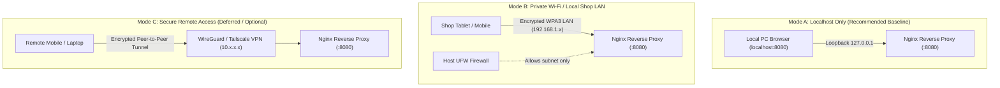

# Network, Firewall & TLS Security Guide

**Project:** Cable Data Manager  
**Audience:** System Administrators & Network Engineers  
**Target Environment:** Local Localhost, Private Wi-Fi/LAN, and Optional Deferred Remote Access

---

## 1. Overview of Deployment Modes

Cable Data Manager is architected to operate in one of three clearly defined access modes:



---

## 2. Mode A — Localhost-Only Deployment (Default & Safest)

### Architecture
- Application is accessible only from a web browser running directly on the server machine.
- Binding: `BIND_IP=127.0.0.1`, `PROD_PORT=8080` in `.env`.
- Attack surface is minimized: zero external network interfaces listen for traffic.

### Configuration
In `.env`:
```ini
BIND_IP=127.0.0.1
PROD_PORT=8080
CORS_ORIGINS=http://localhost:8080,http://127.0.0.1:8080
```

### Verification
Execute on host:
```bash
ss -tlpn | grep 8080
# Output must show: 127.0.0.1:8080 (NOT 0.0.0.0:8080 or :::8080)
```

---

## 3. Mode B — Private Wi-Fi / Local Shop LAN Deployment

### Security Assessment & Critical Warning
> [!WARNING]
> **Mode B (Plain HTTP over Shop LAN) is NOT approved for production.**  
> Transmitting unencrypted customer financial records, collection ledgers, and authentication tokens over plain HTTP on wireless airwaves exposes the business to eavesdropping by any device connected to the shop Wi-Fi. Mode B requires mandatory HTTPS termination and strict host-level interface binding.

### 3.1 Docker Network & Host Firewall (UFW) Bypass Reality
A common and dangerous misconception in Linux systems administration is assuming `sudo ufw allow from 192.168.1.0/24 to any port 8080` protects a containerized service.
- **The Docker iptables Bypass:** When Docker publishes a port (e.g. `8080:8080` without an explicit host IP, or even with standard bindings), Docker manipulates Linux `iptables` directly by inserting `PREROUTING` rules in the `nat` table and forwarding rules into the `DOCKER` filter chain.
- **Why Standard UFW Rules Fail:** UFW controls the `INPUT` chain of the filter table. Traffic routed through Docker's network bridge traverses the `PREROUTING` -> `FORWARD` chains, completely bypassing UFW's `INPUT` filter rules! As a result, an ordinary `ufw deny` or subnet restriction may offer **zero protection** if Docker is allowed to publish freely.

### 3.2 Reliable Enforcement Mechanisms for Mode B:
To genuinely restrict traffic on the host:
1. **Explicit Interface Binding (Primary Defense):**  
   Never bind to wildcard (`0.0.0.0`). Set `BIND_IP` in `.env` to the specific static LAN IP assigned to the server (e.g. `BIND_IP=192.168.1.100`), ensuring the kernel drops packets arriving on other interfaces (such as direct WAN or secondary USB modems).
2. **Docker DOCKER-USER Chain Filtering (Firewall Defense):**  
   Docker explicitly reserves the `DOCKER-USER` iptables chain for custom administrator rules. To enforce subnet isolation via iptables before packets reach Docker:
   ```bash
   # Block all external routing to port 8080 except from the trusted shop subnet:
   sudo iptables -I DOCKER-USER -i eth0 -p tcp --dport 8080 ! -s 192.168.1.0/24 -j DROP
   ```
3. **Mandatory HTTPS Requirement:**  
   Plain HTTP is strictly forbidden for LAN access. Section 5 details the mandatory TLS termination configuration required before Mode B can be deployed.

### Configuration
In `.env`:
```ini
# Bind strictly to server's private static LAN IP:
BIND_IP=192.168.1.100
PROD_PORT=8080

# Update CORS to allow requests originating from the LAN IP:
CORS_ORIGINS=http://192.168.1.100:8080,http://localhost:8080,http://127.0.0.1:8080
```

Restart the stack after changing `.env`:
```bash
docker compose -f docker-compose.prod.yml down
docker compose -f docker-compose.prod.yml up -d
```

---

## 4. Mode C — Remote Access (Optional & Deferred)

### Critical Guidance on Remote Access:
- **Never expose port 8080 or port 5432 directly to the public internet via port forwarding on the ISP router.** Doing so exposes the login endpoint to automated credential stuffing, brute force attacks, and port scanning.
- **Do not purchase cloud VPS or domain names** unless remote field collection is a business necessity.

### Recommended Secure Remote Access Architectures:

#### Architecture C.1: Private Overlay VPN (WireGuard or Tailscale) — Preferred Zero-Cost Option
1. Install WireGuard or Tailscale on the host machine.
2. The server receives a virtual private IP (e.g. `10.8.0.1` or `100.x.y.z`).
3. Set `BIND_IP=10.8.0.1` in `.env`.
4. Only client devices authorized on the VPN mesh network can reach the web interface.
5. All traffic between mobile clients and the local server is end-to-end encrypted with Curve25519 cryptography, requiring no public IP, no open router ports, and no recurring domain registration costs.

#### Architecture C.2: Cloudflare Tunnels (Zero-Trust)
- Cloudflare Tunnel (`cloudflared`) connects outbound from the host to Cloudflare's edge network.
- Requires a custom domain name (annual domain fee).
- Caution: Cloudflare Terms of Service must be checked regarding commercial traffic and data residency.

---

## 5. Reverse Proxy & TLS / HTTPS Readiness

### Current Configuration State
- Current `frontend/nginx.prod.conf` listens on plain HTTP (`listen 8080;`).
- All traffic over `localhost` (Mode A) is entirely on-box loopback, where eavesdropping is impossible without root host access.
- **Important:** HTTPS is **NOT** pre-configured in the source code repository. Deploying in Mode B or Mode C without applying the TLS configuration below is insecure.

### Mandatory TLS Termination Requirements for LAN and Remote Modes:
When running on an untrusted or shared Wi-Fi network (Mode B or remote), TLS termination is mandatory to prevent cleartext HTTP credential interception on the local wireless airwaves.

### How to Enable HTTPS Termination in Nginx:
1. **Self-Signed / Internal CA Certificate Generation:**
   For local LAN usage, generate a local CA certificate using `mkcert` or OpenSSL:
   ```bash
   sudo mkdir -p /etc/cable-manager/certs
   sudo openssl req -x509 -nodes -days 365 -newkey rsa:2048 \
     -keyout /etc/cable-manager/certs/server.key \
     -out /etc/cable-manager/certs/server.crt \
     -subj "/CN=cable-manager.local"
   sudo chmod 600 /etc/cable-manager/certs/server.key
   ```

2. **Mounting Certificates into Frontend Container:**
   Update `docker-compose.prod.yml` frontend service:
   ```yaml
   volumes:
     - /etc/cable-manager/certs:/etc/nginx/certs:ro
   ```

3. **Nginx Configuration Directives for SSL:**
   Update `frontend/nginx.prod.conf`:
   ```nginx
   # Redirect plain HTTP to HTTPS
   server {
       listen 8080;
       server_name _;
       return 301 https://$host:8443$request_uri;
   }

   # Secure HTTPS Server
   server {
       listen 8443 ssl;
       server_name _;

       ssl_certificate /etc/nginx/certs/server.crt;
       ssl_certificate_key /etc/nginx/certs/server.key;
       ssl_protocols TLSv1.2 TLSv1.3;
       ssl_ciphers HIGH:!aNULL:!MD5;
       ssl_prefer_server_ciphers on;
       ssl_session_cache shared:SSL:10m;
       ssl_session_timeout 1d;
       ...
   }
   ```

4. **Security Headers Already Injected:**
   `frontend/nginx.prod.conf` already injects:
   - `X-Frame-Options: SAMEORIGIN` (Clickjacking defense)
   - `X-Content-Type-Options: nosniff` (MIME-sniffing defense)
   - `Referrer-Policy: strict-origin-when-cross-origin`
   - `X-XSS-Protection: 1; mode=block`
