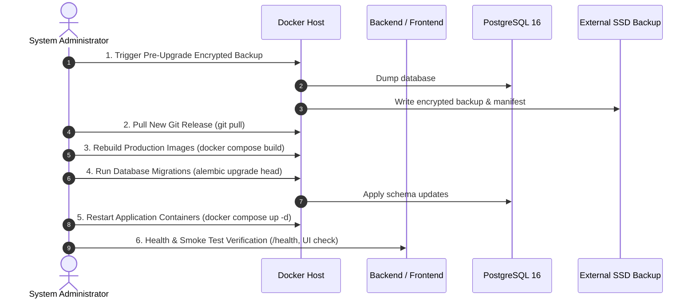

# Production Upgrade, Recovery & Rollback Guide

**Project:** Cable Data Manager  
**Audience:** System Administrators & Database Reliability Engineers  
**Scope:** Controlled Application Updates, Database Migration Traversal, Host Failure Recovery

---

## 1. Safe Application Upgrade Workflow

All production upgrades must follow a strict **Backup-First, Migrate-Second, Verify-Third** protocol.



### Detailed Step-by-Step Upgrade Procedure:

1. **Step 1: Execute a Mandatory Pre-Upgrade Backup**
   Never upgrade software without an immutable snapshot of the existing database:
   ```bash
   cd /opt/cable-manager
   sudo -u root /bin/bash scripts/backup/backup-postgres.sh
   # Confirm backup status is healthy
   scripts/backup/backup-status.sh
   ```

2. **Step 2: Pull Verified Release Code**
   ```bash
   git fetch origin
   git checkout <release-tag>
   # Verify commit signature or release notes
   ```

3. **Step 3: Rebuild Docker Images**
   ```bash
   docker compose -f docker-compose.prod.yml build
   ```

4. **Step 4: Execute Database Migrations**
   Run Alembic migrations through a one-off backend container before restarting running services:
   ```bash
   docker compose -f docker-compose.prod.yml run --rm backend alembic upgrade head
   ```

5. **Step 5: Apply Updated Containers**
   ```bash
   docker compose -f docker-compose.prod.yml up -d
   ```

6. **Step 6: Post-Upgrade Health Check**
   ```bash
   curl -i http://127.0.0.1:8080/health
   # Expected: {"status":"healthy","database":"connected"}
   ```

---

## 2. Rollback Strategy & Migration Realities

### Critical Rule: Application Rollback vs. Database Rollback
- **Application Code Rollback:** Switching back to an older Docker image or Git commit is straightforward and takes seconds.
- **Database Rollback:** If a database migration has already been executed (`alembic upgrade head`), simply rolling back the application code can cause severe runtime errors if the older code expects the previous database schema.

### Rollback Scenarios:

#### Scenario A: Upgrade Failed Before Running Migrations
If Docker build fails or pre-upgrade checks fail:
```bash
git checkout <previous-tag>
docker compose -f docker-compose.prod.yml up -d
```
No database restoration is needed; production remains untouched.

#### Scenario B: Upgrade Failed After Schema Migrations Were Applied
If the new code introduces unexpected bugs after running migrations:
1. **Option 1: Safe Migration Downgrade (Preferred if schema permits):**
   ```bash
   docker compose -f docker-compose.prod.yml run --rm backend alembic downgrade <previous-revision>
   git checkout <previous-tag>
   docker compose -f docker-compose.prod.yml build
   docker compose -f docker-compose.prod.yml up -d
   ```
2. **Option 2: Complete Database Restore from Pre-Upgrade Backup:**
   If a migration was destructive or irreversible:
   ```bash
   # Stop application containers to prevent new writes
   docker compose -f docker-compose.prod.yml stop backend frontend

   # Restore pre-upgrade encrypted backup into production DB
   /opt/cable-manager/scripts/backup/restore-postgres.sh \
     --backup-file /mnt/cable-manager-backups/cable_backup_<pre_upgrade_timestamp>.dump.gpg \
     --target-db cable_manager \
     --gpg-key /path/to/offline_private_key.asc \
     --force-production-restore-i-know-what-i-am-doing

   # Switch back code and start containers
   git checkout <previous-tag>
   docker compose -f docker-compose.prod.yml up -d
   ```

> [!CAUTION]
> **NEVER** run `docker compose down -v` or delete Docker volumes as a troubleshooting step. Deleting volumes permanently destroys all customer accounts, billing records, and financial passbooks.

---

## 3. Host Failure & Bare-Metal Replacement Procedure

If the server computer suffers catastrophic hardware failure (motherboard, internal SSD, or CPU failure):

1. **Procure Replacement Hardware:**
   Set up any standard x86_64 desktop or mini-PC with Ubuntu Server / Desktop 22.04 LTS or 24.04 LTS and install Docker CE.
2. **Clone Application Repository:**
   ```bash
   sudo mkdir -p /opt/cable-manager
   sudo chown $USER:$USER /opt/cable-manager
   git clone <repo-url> /opt/cable-manager
   cd /opt/cable-manager
   ```
3. **Recreate `.env` Configuration:**
   Restore `.env` from secure offline administrative records (or configure matching parameters).
4. **Attach External Backup SSD:**
   Plug the external backup SSD into the new host and mount at `/mnt/cable-manager-backups`.
5. **Start Clean PostgreSQL Database Container:**
   ```bash
   docker compose -f docker-compose.prod.yml up -d db
   ```
6. **Restore Latest Production Backup:**
   Mount the offline private GPG key and execute restore:
   ```bash
   LATEST_BACKUP=$(ls -1t /mnt/cable-manager-backups/*.dump.gpg | head -n 1)

   scripts/backup/restore-postgres.sh \
     --backup-file "$LATEST_BACKUP" \
     --target-db cable_manager \
     --gpg-key /path/to/cable_backup_private.asc \
     --force-production-restore-i-know-what-i-am-doing
   ```
7. **Launch Complete Application Stack:**
   ```bash
   docker compose -f docker-compose.prod.yml up -d
   ```
8. **Verify System Integrity:**
   Log in to the web interface and verify that customer records, dues, and payment records match the state of the last backup.
